# ga-grafiksymbole

Freie SVG-Symbole für Px-Grafiken der Gebäudeautomation (Niagara 4) – Lüftung, Heizung, Kälte, Hydraulik und Anzeigen.

Die Symbole sind für den Einsatz in Niagara Px als `Picture` mit `scale = fitRatio` gedacht. Alle Symbole liegen ausschließlich als SVG vor, auch die animierten (SMIL); Schrift ist immer als Pfad gezeichnet.

## Inhalt

```
symbole/                 nur SVG-Dateien
  allgemein/             Fachübergreifend: Flusspfeile (Wasser, Luft, Strom), Trennung/Durchführung
  lueftung/              Klimakonvektor, Volumenstromregler, Deckenluftdurchlass, WRG
  hydraulik/             Absperrklappe, Energieventil, Zähler, Zortström-Speicher, Kessel, Wärmepumpe, Pumpe
  anzeigen/              LEDs (rund und eckig), blinkende Punkte, Betriebsart Normal/Leise
  fun/                   Verspielte Cartoon-Symbole (Außentemperatur, -feuchte, CO₂), animiert; Monatsleiste
    button/              Cartoon-Navigationsbuttons 280 × 72, je normal und aktiv
  topologie/             Topologiesymbole (Controller/IO, Netzwerk, Infrastruktur, Geräte,
                         Ventile, Energie- und Wasserzähler, Schaltschränke)
docs/
  STYLEGUIDE.md          Farben, Strichstärken, Proportionen
  NIAGARA.md             Einbindung in Px, Positionierung, Fallstricke
  SYMBOLKATALOG.md       Abmessungen und Anschlusspunkte je Symbol
  uebersicht/            Übersichtsgrafik je Symbolverzeichnis (PNG)
tools/
  check_symbols.py       Prüft symbole/ auf Regeln (nur SVG, kein <text>, Namensschema)
  text_zu_pfad.ps1       Wandelt <text> in einer SVG in Pfade um (Windows)
  pumpe.py               Erzeugt die Pumpensymbole unter symbole/hydraulik/
  rauch.py               Erzeugt den Brennerrauch unter symbole/hydraulik/ (animiert + statisch)
  flamme.py              Erzeugt die Brennerflammen unter symbole/hydraulik/ (animiert + statisch)
  fun_pumpe.py           Erzeugt die Fun-Pumpen unter symbole/fun/ (baut auf pumpe.py auf)
  waermepumpe.py         Erzeugt die Wärmepumpen-Symbole unter symbole/hydraulik/
  klappen.py             Erzeugt die Klappensymbole unter symbole/lueftung/klappen/{klein,gross}/
  monatsleiste.ps1       Erzeugt symbole/fun/Fun_Monatsleiste.svg (Windows, Schrift als Pfade)
  zip_erstellen.py       Packt symbole/ und LICENSE in dist/ga-grafiksymbole.zip (von der Action genutzt)
  uebersichten.py        Erzeugt die Übersichtsgrafiken in docs/uebersicht/ aus den SVGs (Pillow, resvg-py)
```

## Download

Alle Symbole inklusive Verzeichnisstruktur als ein Archiv:
[ga-grafiksymbole.zip](https://github.com/simsum/ga-grafiksymbole/releases/latest/download/ga-grafiksymbole.zip)
(aktueller Stand, siehe auch [Releases](https://github.com/simsum/ga-grafiksymbole/releases)). Das Archiv enthält den Ordner `symbole/` und die Lizenz.

Es wird bei jeder Änderung an `symbole/` automatisch von einer GitHub Action gebaut (`.github/workflows/zip.yml`) und liegt als Anhang am Release `latest`, nicht im Repository.

## Übersicht der Symbole

Jede Grafik zeigt alle Symbole eines Verzeichnisses mit Dateinamen und Größe.

### Allgemein – `symbole/allgemein`
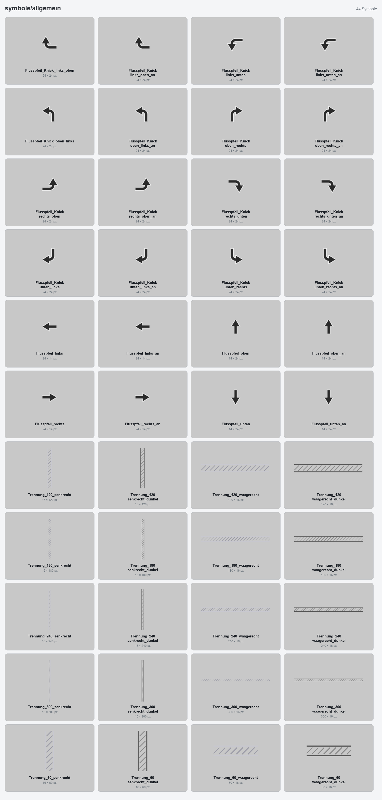

### Lüftung – `symbole/lueftung`
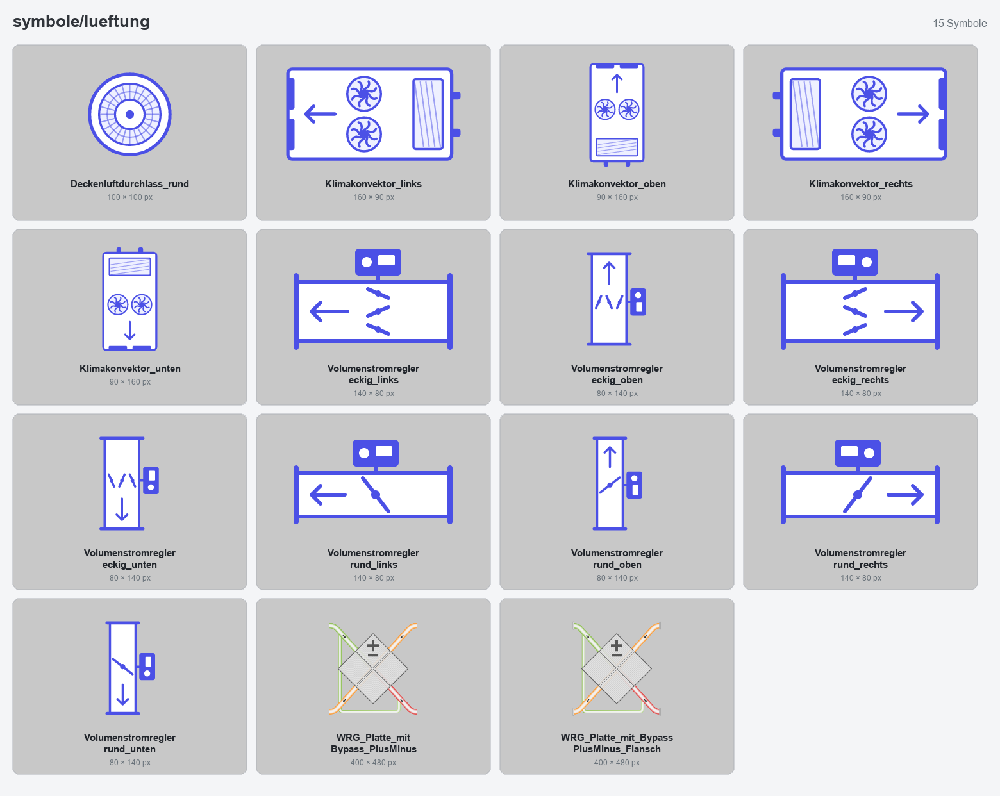

### Lüftung, Klappen klein – `symbole/lueftung/klappen/klein`


### Lüftung, Klappen groß – `symbole/lueftung/klappen/gross`
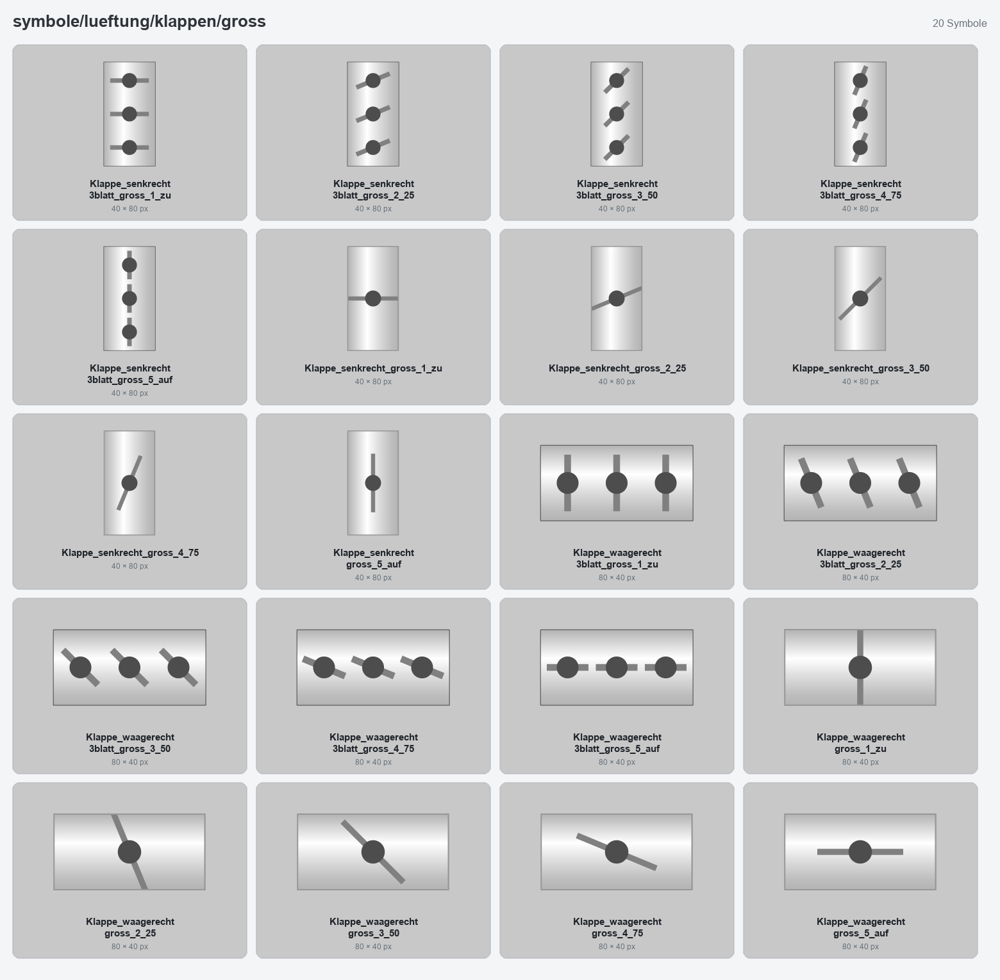

### Hydraulik – `symbole/hydraulik`
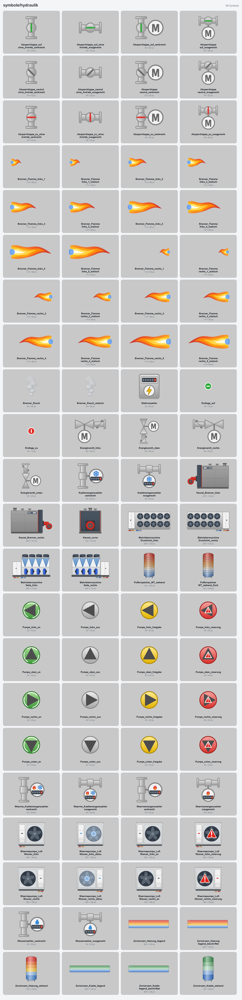

### Anzeigen – `symbole/anzeigen`
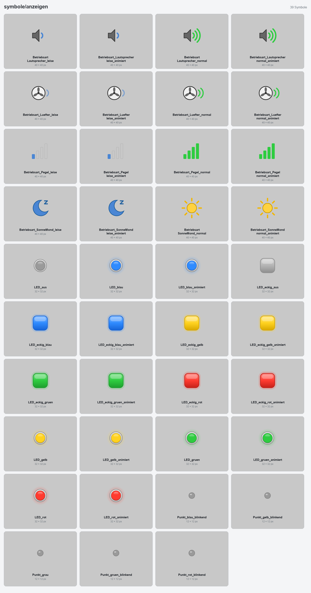

### Fun – `symbole/fun`
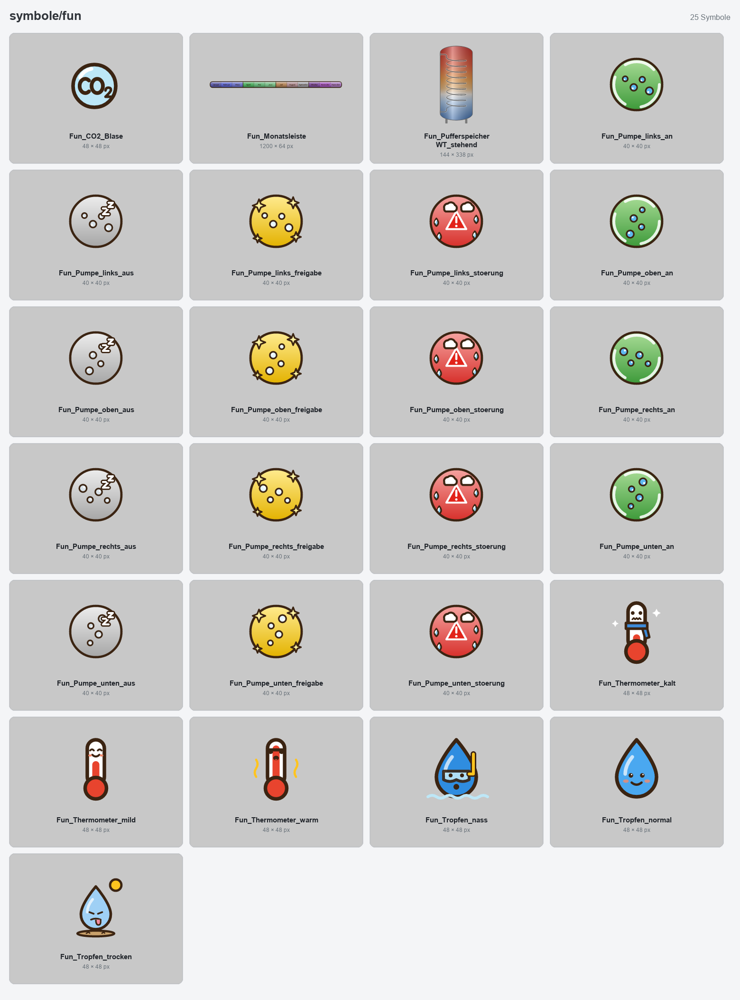

### Fun-Buttons – `symbole/fun/button`
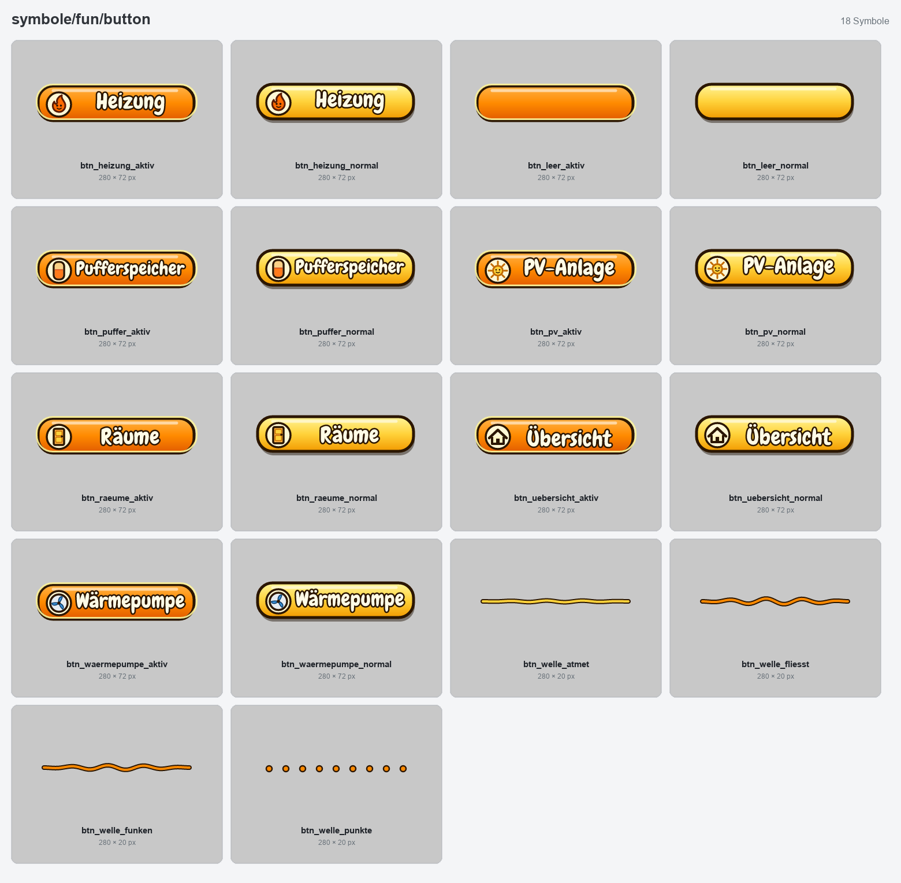

### Topologie – `symbole/topologie`

**Controller und I/O-Module** (`controller_io`)
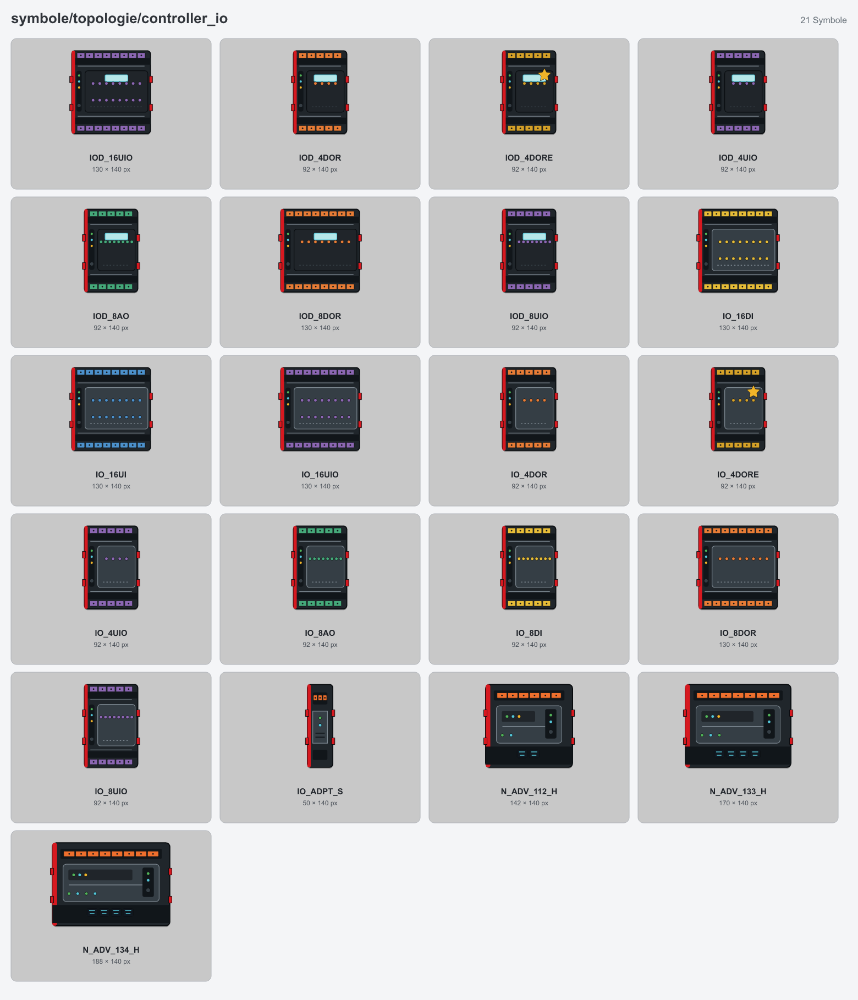

**Netzwerk** (`netzwerk`)
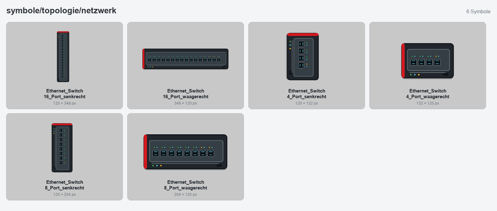

**Infrastruktur** (`infrastruktur`)
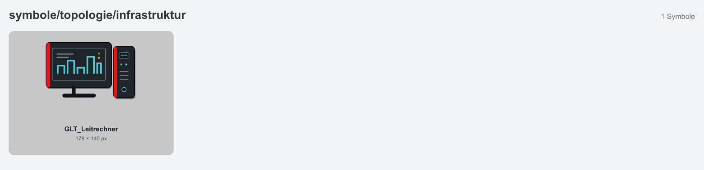

**Allgemeine Geräte** (`geraete`)
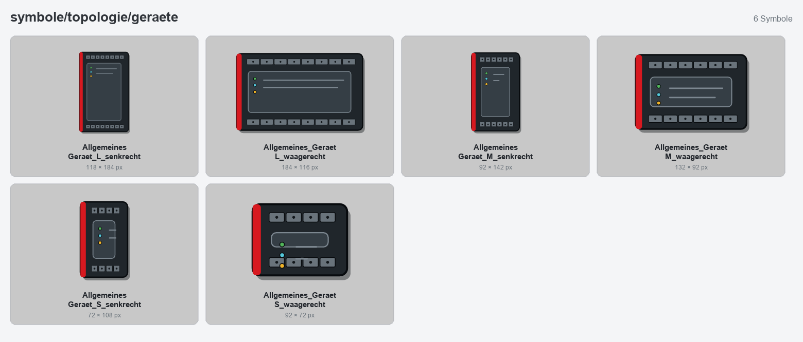

**Ventile** (`ventile`)
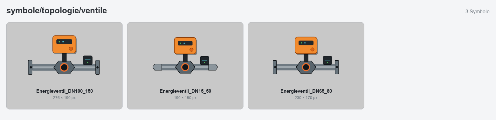

**Energiezähler** (`energiezaehler`)
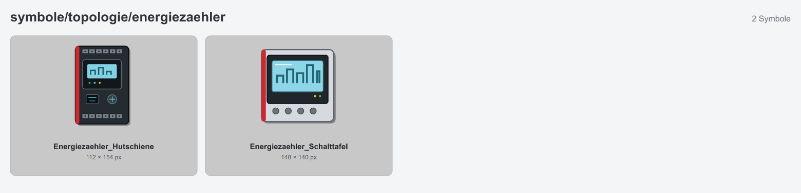

**Wasserzähler** (`wasserzaehler`)
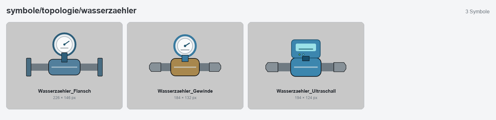

**Schaltschränke** (`schaltschraenke`)


## Verwendung in Niagara

1. SVG-Dateien nach `file:^px/GraphicTemplates/symbole/` in der Station kopieren.
2. In Px ein `Picture` anlegen, `image` auf die Datei setzen, `scale = fitRatio`.
3. Beschriftungen und Werte als Niagara-Label darüberlegen (die Symbole enthalten bewusst keinen Text).

Details: [docs/NIAGARA.md](docs/NIAGARA.md).

## Konventionen

- Keine Texte, Nummern oder Herstellerlogos in den Symbolen.
- Symbole mit Richtung gibt es in allen vier Richtungen.
- Symbole einer Familie haben identische Abmessungen.
- Dateinamen: `<Symbol>_<Richtung/Variante>.svg`, nur Unterstriche (Niagara mag keine Bindestriche), Umlaute ausgeschrieben, z. B. `Klimakonvektor_rechts.svg`.
- Bestehende Symbole werden nur nach Rückfrage umbenannt, da Px-Seiten auf die Dateinamen verweisen.

Siehe [docs/STYLEGUIDE.md](docs/STYLEGUIDE.md) und [CONTRIBUTING.md](CONTRIBUTING.md).

## Haftung und Marken

Die Symbole sind eigenständig gezeichnet und neutral gehalten. „Niagara“, „Honeywell“ und weitere genannte Namen sind Marken ihrer jeweiligen Inhaber. Dieses Projekt steht in keiner Verbindung zu diesen Unternehmen und enthält keine Dateien aus deren Symbolbibliotheken. Bezeichnungen wie „Honeywell-Stil“ beschreiben nur die visuelle Anmutung.

Die Nutzung erfolgt auf eigene Verantwortung, ohne Gewähr.

## Lizenz

[Creative Commons Namensnennung 4.0 International (CC BY 4.0)](LICENSE)

Die Symbole dürfen frei genutzt, verändert und weitergegeben werden, auch kommerziell, wenn die Urheberschaft genannt wird, zum Beispiel: „Symbole: Sven Steinmeier, https://github.com/simsum/ga-grafiksymbole, CC BY 4.0“. Änderungen sind kenntlich zu machen.
