# ga-grafiksymbole

Freie SVG-Symbole für Px-Grafiken der Gebäudeautomation (Niagara 4) – Lüftung, Heizung, Kälte, Hydraulik und Anzeigen.

Die Symbole sind für den Einsatz in Niagara Px als `Picture` mit `scale = fitRatio` gedacht. Pro Symbol genügt ein SVG, eine gleichnamige PNG liegt als Ausweichlösung bei.

## Inhalt

```
symbole/                 je Ordner SVG und PNG mit gleichem Namen nebeneinander
  lueftung/              Klimakonvektor, Volumenstromregler, Deckenluftdurchlass, WRG
  hydraulik/             Absperrklappe, Energieventil, Zähler, Zortström-Speicher, Kessel, Flusspfeile
  anzeigen/              LEDs
  topologie/             Topologiesymbole (Controller/IO, Netzwerk, Infrastruktur, Geräte,
                         Ventile, Energie- und Wasserzähler, Schaltschränke)
docs/
  STYLEGUIDE.md          Farben, Strichstärken, Proportionen
  NIAGARA.md             Einbindung in Px, Positionierung, Fallstricke
  SYMBOLKATALOG.md       Abmessungen und Anschlusspunkte je Symbol
  uebersicht/            Übersichtsgrafik je Symbolverzeichnis (PNG)
tools/
  check_symbols.py       Prüft SVGs auf Regeln (kein <text>, Namensschema, PNG vorhanden)
```

## Übersicht der Symbole

Jede Grafik zeigt alle Symbole eines Verzeichnisses mit Dateinamen und Größe.

### Lüftung – `symbole/lueftung`
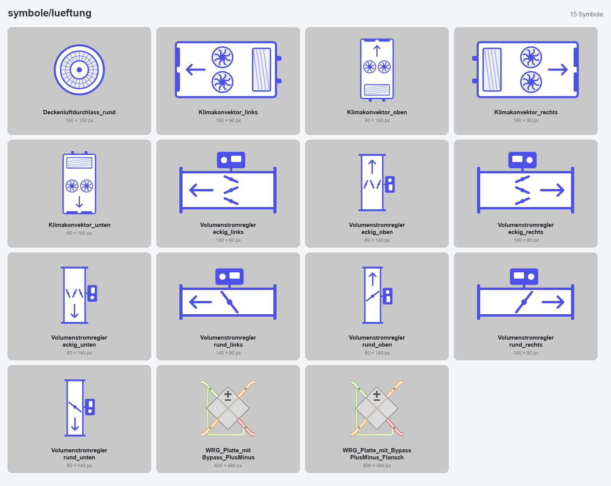

### Hydraulik – `symbole/hydraulik`
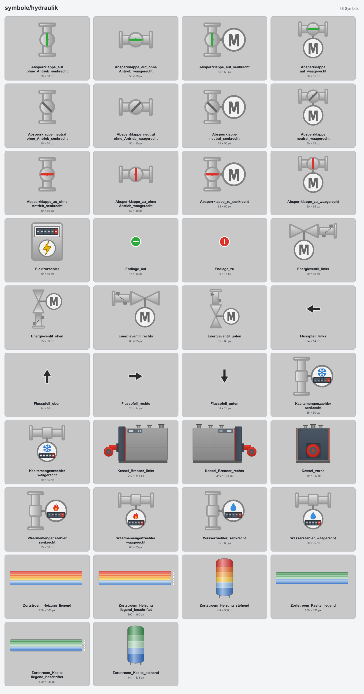

### Anzeigen – `symbole/anzeigen`
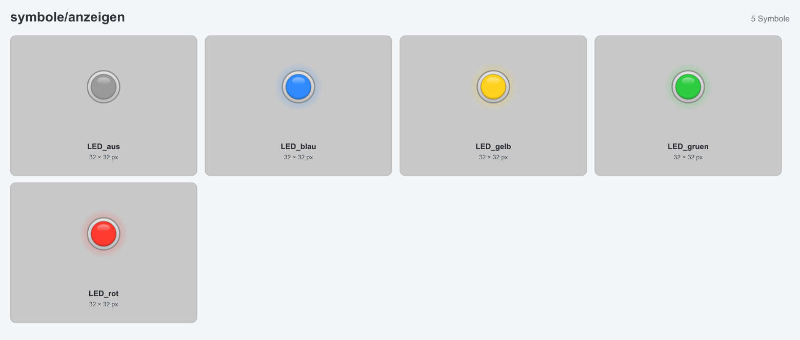

### Topologie – `symbole/topologie`

**Controller und I/O-Module** (`controller_io`)
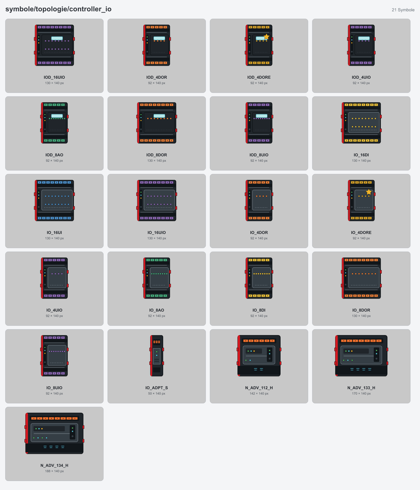

**Netzwerk** (`netzwerk`)
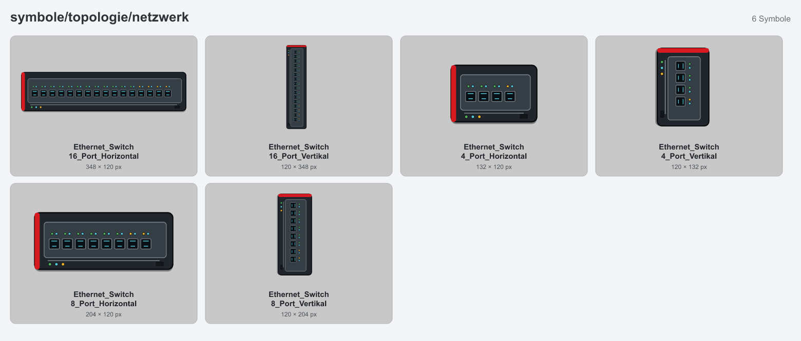

**Infrastruktur** (`infrastruktur`)
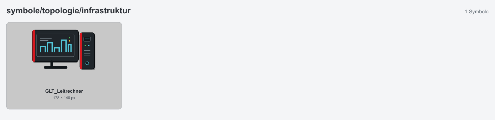

**Allgemeine Geräte** (`geraete`)
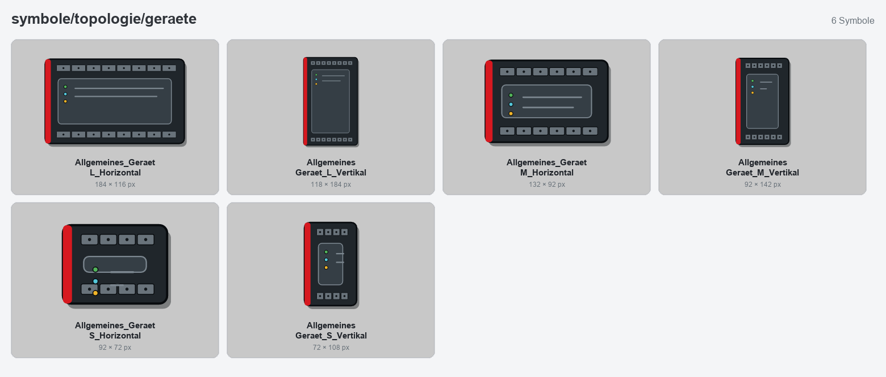

**Ventile** (`ventile`)
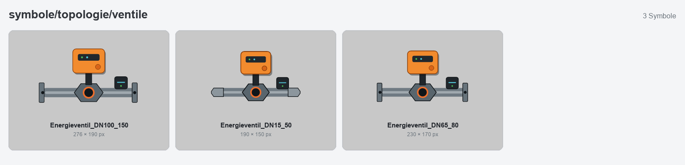

**Energiezähler** (`energiezaehler`)
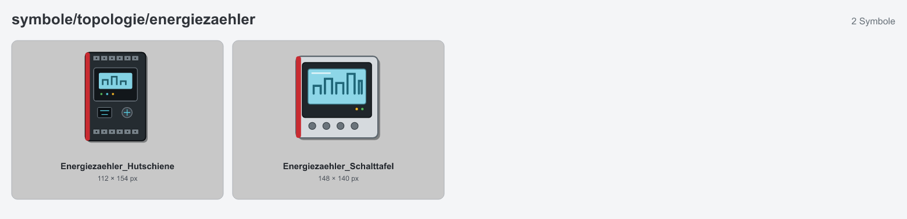

**Wasserzähler** (`wasserzaehler`)
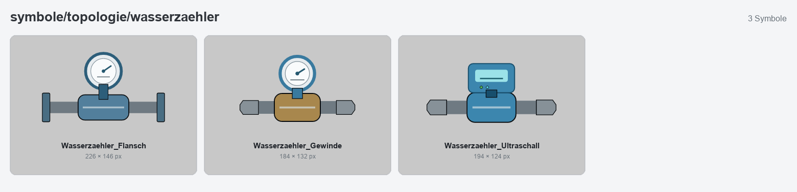

**Schaltschränke** (`schaltschraenke`)
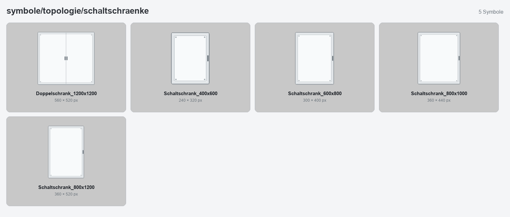

## Verwendung in Niagara

1. SVG- und PNG-Dateien nach `file:^px/GraphicTemplates/symbole/` in der Station kopieren.
2. In Px ein `Picture` anlegen, `image` auf die Datei setzen, `scale = fitRatio`.
3. Beschriftungen und Werte als Niagara-Label darüberlegen (die Symbole enthalten bewusst keinen Text).

Details: [docs/NIAGARA.md](docs/NIAGARA.md).

## Konventionen

- Keine Texte, Nummern oder Herstellerlogos in den Symbolen.
- Symbole mit Richtung gibt es in allen vier Richtungen.
- Symbole einer Familie haben identische Abmessungen.
- Dateinamen: `<Symbol>_<Richtung/Variante>.svg`, nur Unterstriche (Niagara mag keine Bindestriche), Umlaute ausgeschrieben, z. B. `Klimakonvektor_rechts.svg`.
- Bestehende Symbole werden nur nach Rückfrage umbenannt, da Px-Seiten auf die Dateinamen verweisen.

Siehe [docs/STYLEGUIDE.md](docs/STYLEGUIDE.md) und [CONTRIBUTING.md](CONTRIBUTING.md).

## Haftung und Marken

Die Symbole sind eigenständig gezeichnet und neutral gehalten. „Niagara“, „Honeywell“ und weitere genannte Namen sind Marken ihrer jeweiligen Inhaber. Dieses Projekt steht in keiner Verbindung zu diesen Unternehmen und enthält keine Dateien aus deren Symbolbibliotheken. Bezeichnungen wie „Honeywell-Stil“ beschreiben nur die visuelle Anmutung.

Die Nutzung erfolgt auf eigene Verantwortung, ohne Gewähr.

## Lizenz

[Creative Commons Namensnennung 4.0 International (CC BY 4.0)](LICENSE)

Die Symbole dürfen frei genutzt, verändert und weitergegeben werden, auch kommerziell, wenn die Urheberschaft genannt wird, zum Beispiel: „Symbole: Sven Steinmeier, https://github.com/simsum/ga-grafiksymbole, CC BY 4.0“. Änderungen sind kenntlich zu machen.
